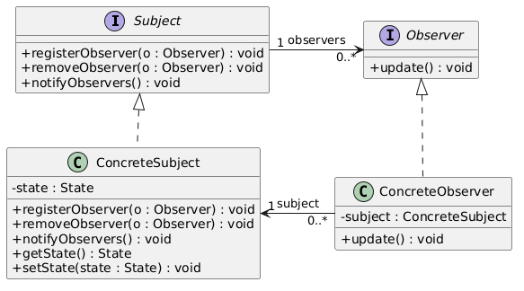
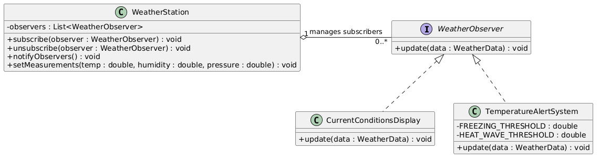

# Weather Station - Observer Design Pattern Implementation

A Java 17 reference implementation of the Observer design pattern demonstrating an event-driven architecture using a weather monitoring system domain.

## Overview

The Observer pattern is a behavioral design pattern that establishes a one-to-many dependency between objects. When a central object (the Subject/Observable) undergoes a state change, all registered dependents (Observers) are notified and updated automatically.

This repository demonstrates the pattern using a real-world scenario: a weather monitoring station (`WeatherStation`) measuring environmental data (`WeatherData`) and broadcasting measurements to multiple independent consumer components (`CurrentConditionsDisplay`, `TemperatureAlertSystem`, and custom logging subscribers).

## Design Pattern Architecture

### Theoretical Structure

The classic Gang of Four (GoF) Observer pattern consists of four core participants:
1. **Subject (Interface)**: Defines the contract for subscribing, unsubscribing, and notifying observers.
2. **Observer (Interface)**: Defines the update interface for objects that should be notified of changes.
3. **ConcreteSubject**: Maintains state and sends notifications to attached observers when state changes occur.
4. **ConcreteObserver**: Implements the Observer interface to maintain consistency with the Subject's state.



### Domain Implementation

In this implementation:
- `WeatherStation` acts as the **Concrete Subject**.
- `WeatherObserver` acts as the **Observer Interface**.
- `CurrentConditionsDisplay` and `TemperatureAlertSystem` act as **Concrete Observers**.
- `WeatherData` is an immutable data payload (Java Record) transferred via the **Push Model**.



## Component Mapping

| Pattern Participant | Project Class | Description |
| :--- | :--- | :--- |
| **Subject Interface** | `Observable` / `WeatherStation` | Manages subscriber list and broadcasts measurements |
| **Observer Interface** | `WeatherObserver` | `@FunctionalInterface` declaring `update(WeatherData data)` |
| **Concrete Observer A** | `CurrentConditionsDisplay` | Renders real-time telemetry output |
| **Concrete Observer B** | `TemperatureAlertSystem` | Evaluates threshold conditions for freezing or heat alerts |
| **Data Payload** | `WeatherData` | Immutable `record` carrying temperature, humidity, and pressure |

## Project Structure

```text
weather-station-observer-pattern/
├── README.md
├── docs/
│   └── diagrams/
│       ├── observer-pattern-theory.png
│       └── weather-station-class-diagram.png
└── src/
    └── main/
        └── java/
            ├── WeatherData.java
            ├── WeatherObserver.java
            ├── WeatherStation.java
            ├── CurrentConditionsDisplay.java
            ├── TemperatureAlertSystem.java
            └── WeatherApp.java
```

## Technical Highlights

- **Push Model Data Transfer**: State is passed directly to `update(WeatherData data)`, eliminating the need for observers to query the subject back.
- **Loose Coupling**: The `WeatherStation` depends exclusively on the `WeatherObserver` interface, enabling new subscribers without modifying existing code.
- **Java 17 Features**: Utilizes Java `record` constructs for concise immutable data transfers and `@FunctionalInterface` to support lambda expression subscribers.

## Build and Execution

### Prerequisites

- Java Development Kit (JDK) 17 or higher.

### Compilation

From the repository root, compile all source files into a target build directory:

```bash
javac -d bin src/main/java/*.java
```

### Execution

Run the demonstration application:

```bash
java -cp bin WeatherApp
```

### Sample Output

```text
=== Sensor Reading 1: Normal Day ===
[Display Screen] Temp: 22.5°C | Humidity: 65.0% | Pressure: 1013.2 hPa
[DataLogger] Saved metrics to database at 1729075000000

=== Sensor Reading 2: Cold Wave ===
[Display Screen] Temp: -2.0°C | Humidity: 80.0% | Pressure: 1020.5 hPa
[ALERT SYSTEM] Frost warning! Temperature dropped to -2.0°C
[DataLogger] Saved metrics to database at 1729075000000

=== Sensor Reading 3: Heat Wave ===
[Display Screen] Temp: 38.0°C | Humidity: 40.0% | Pressure: 1008.0 hPa
[ALERT SYSTEM] Extreme heat warning! Temperature reached 38.0°C
[DataLogger] Saved metrics to database at 1729075000000
```

## License

This project is licensed under the MIT License.
